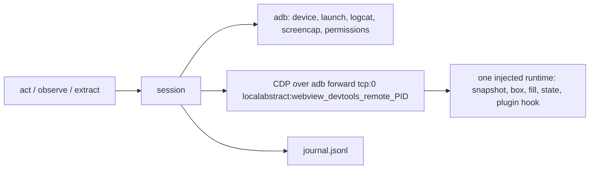

# effing-use-mobile — what shipped

**Date:** 2026-11-21 · **Status:** built, unit-, DOM-, device- and real-Capacitor-app-verified (§4, §5). Plugin-call recording and CapacitorHttp still untested (§6).
natively and through Docker (§4). Not verified against a real Capacitor app (§5).

The mobile half of `effing-use`: three MCP tools that treat a Capacitor app's
WebView as the app and the device as the shell around it. It ships as its **own
package** in [`mobile/`](../mobile/README.md) — npm `effing-use-mobile`, its own
container image, its own release tag namespace (`mobile-v*`). It keeps the browser
server's journal format, delta semantics and error vocabulary, so a session, an
envelope and a `[eN]` ref mean the same thing on both.

---

## 1. Decisions taken

The research (`docs/RESEARCH-mobile.md` §14) left five open. Answering all
"recommended", with two corrections found while building:

| #    | Decision     | Chosen                                             | Why                                                                                                                                                                                                                              |
| ---- | ------------ | -------------------------------------------------- | -------------------------------------------------------------------------------------------------------------------------------------------------------------------------------------------------------------------------------- |
| 14.1 | Repo layout  | **own package in this repo, `mobile/`**            | own npm name, own image, own tags and CI — while still one git history. Shared logic is vendored (journal, delta) and guarded by `tests/parity.test.ts`                                                                          |
| 14.2 | Runtime      | **Bun, not Node** (change from the recommendation) | this repo's imports use `.js` specifiers, which Bun and tsc resolve to `.ts` and Node does not. Node support needs a build step, not a shebang. Every module uses only `node:` APIs, so a `dist` build is the whole upgrade path |
| 14.3 | iOS strategy | `ios_webkit_debug_proxy` first                     | no app changes; still unbuilt (no Mac here)                                                                                                                                                                                      |
| 14.4 | Start point  | Android spike on this machine                      | adb 36 and AVD `ikoro` are here                                                                                                                                                                                                  |
| 14.5 | Scope        | Capacitor-first, generic WebView attach            | nothing Capacitor-specific in the attach path; `appId` detection is the only Capacitor-aware code                                                                                                                                |

## 2. Surface

Three tools, `tools/list` = **3,938 bytes / 3 tools (~1,085 tokens)**, measured
with `bun bench/mcp-size.ts bun mobile/src/index.ts`.

| Tool             | Values                                                                                                                                                              |
| ---------------- | ------------------------------------------------------------------------------------------------------------------------------------------------------------------- |
| `mobile_act`     | `attach, launch, terminate, reload, open_url, tap, fill, type, press, swipe, scroll, back, wait, deep_link, permission, orientation, appearance, eval, note, batch` |
| `mobile_observe` | `snapshot, screenshot, url, title, console, network, errors, logs, plugins, device, apps, state, timeline`                                                          |
| `mobile_extract` | `text, html, table, query, har`                                                                                                                                     |

For comparison, measured the same way: `@mobilenext/mobile-mcp` 33,615 B (8.5×),
`appium-mcp` 43,291 B (11×).

New capability is an enum value, never a fourth tool. The values that are absent
are absent on purpose: no `push` (needs an FCM/receiver path), no `route`
(request interception on WebView is unreliable), no `pdf`/`trace` (not supported
by a WebView target), no `sync` (that is `npx cap sync`, which the agent can run
itself).

## 3. How it works



- **Attach**: `pidof <pkg>` → `/proc/net/unix` → the app's
  `webview_devtools_remote_<pid>` socket → `adb forward tcp:0` (adb picks a free
  port) → `/json/list` → connect the page target's WebSocket. The URL adb returns
  is rewritten to the forwarded port.
- **One runtime**: `Page.addScriptToEvaluateOnNewDocument` installs
  `window.__effing` once, so it survives reloads and each action is a single
  `Runtime.evaluate` returning JSON.
- **Refs**: indices into a per-snapshot array on the page. `box()` re-checks
  `isConnected` and scrolls into view; a detached element returns `E_STALE`
  rather than clicking a stranger. `box()` also hit-tests the centre point, so a
  covering overlay is reported (`hit: false`, `coveredBy`) instead of silently
  eating the tap.
- **Touch, not mouse**: `Input.dispatchTouchEvent` for tap/swipe, because mobile
  UIs bind touch handlers; `scroll` uses `Input.synthesizeScrollGesture`, the
  only dispatch that actually moves a scroller (see §5). `back` goes through
  `adb shell input keyevent 4` because Back belongs to the activity, not the
  WebView. Every dispatched input is followed by a settle (two animation frames
  - `MOBILE_SETTLE_MS`).
- **Rings + journal**: console/network live in memory for speed and are appended
  to the same JSONL format the browser server uses; `errors` and `timeline` read
  the journal, so evidence survives a detach.

### Docker

The container has no USB bus, so it drives the **host's adb server** over TCP
(`ADB_SERVER_SOCKET`). Two consequences, both learned the hard way:

1. `adb forward` binds the forwarded port on the machine running the adb server,
   so a container must dial the host (`MOBILE_CDP_HOST=host.docker.internal`) and
   the host server must listen on all interfaces (`adb -a -P 5037`). With `-a` the
   forward binds `*:port`, not `127.0.0.1:port`.
2. Chrome's devtools HTTP server rejects any `Host` header that is not an IP or
   `localhost` (DNS-rebinding guard). `http://host.docker.internal:PORT/json/list`
   therefore answers `500 Host header is specified and is not an IP address or
localhost`. The session resolves `MOBILE_CDP_HOST` to an IPv4 address and uses
   it for both the HTTP listing and the WebSocket upgrade.

## 4. Verified here

| Claim                                                                   | Evidence               |
| ----------------------------------------------------------------------- | ---------------------- |
| Handshake ≤ 5 KB                                                        | 3,938 B, 3 tools       |
| Runtime parses and has no accidental interpolation                      | `tests/mobile.test.ts` |
| Snapshot finds visible controls, skips `display:none` and `aria-hidden` | live Chrome test       |
| Shadow-DOM controls are refs and `fill` reaches the native input        | live Chrome test       |
| `fill` events cross the shadow boundary (`composed: true`)              | live Chrome test       |
| A replaced element returns `E_STALE`                                    | live Chrome test       |
| `capacitor.config.ts` / `.json` parsing, incl. refusing computed values | `tests/mobile.test.ts` |
| HAR 1.2 from the network ring                                           | `tests/mobile.test.ts` |
| Version resolves from package.json when installed from npm or in Docker | `tests/mobile.test.ts` |
| Mobile and browser snapshot deltas agree on the same fixtures           | `tests/parity.test.ts` |
| Package suite, own deps only                                            | 20 pass, 1 skip        |

**Phase 0 on the emulator** (AVD `ikoro`, fresh boot, Android WebView Shell as
the attachable WebView — a Capacitor app is not needed to prove the transport):

| Step                                                      | Measured                                | Research target |
| --------------------------------------------------------- | --------------------------------------- | --------------- |
| attach + `kind=state` (adb forward, `/json/list`, inject) | 230–560 ms                              | < 500 ms        |
| snapshot after attach                                     | 19–44 ms                                | < 100 ms        |
| fill (ref → native setter → composed events)              | 17–20 ms                                | —               |
| tap (`Input.dispatchTouchEvent`)                          | 64 ms first, 241 ms under emulator load | < 150 ms        |
| delta after an action                                     | 5–8 ms                                  | —               |
| delta after a no-op                                       | 10–20 ms, `unchanged: true` (~20 tok)   | < 100 tokens    |
| screenshot (`adb exec-out screencap`)                     | 839 ms, 121 KB file path                | —               |

Every action and kind was called at least once on the device. The loop produced
what it is supposed to: after `fill` + `tap`,

```
…1 unchanged nodes…
[changed] [e1] button "Signed in" #go [disabled]
[removed] [e1] button "Sign in" #go
```

and `extract kind=text` read back `signed in as dev@example.com`, so the touch
reached the app's own `onclick` and the typed value reached the app's own state —
not just the DOM.

**The same loop through Docker** (`effing-use-mobile:local`, host adb server,
emulator on the host): attach 237 ms, snapshot 47 ms, fill 18 ms, tap 364 ms
(includes the settle), delta correctly showing
`[changed] button "Signed in" [disabled]`, no-op delta 19 ms, screenshot written
to the mounted volume. So the container path is not a theory — it drove the same
emulator the native path did.

Five bugs testing found that no unit test could:

1. `Network.enable` / `Log.enable` were never sent, so the network and console
   rings stayed empty forever and looked like a silent app.
2. A tap that visibly worked was invisible to a delta 11 ms later:
   `Input.dispatchTouchEvent` resolves when the gesture is queued, not when the
   page has handled it. Inputs now settle (two animation frames + `MOBILE_SETTLE_MS`).
3. `@tmcp/adapter-valibot` was never a dependency — it resolved from the parent
   `node_modules` locally and the container died on startup.
4. `../../package.json` for the version only works in the repo; it breaks for an
   npm install and inside the image. Now resolved by walking up and matching the
   package name.
5. The devtools HTTP listing hardcoded `127.0.0.1`, which is wrong inside any
   container, and the error surfaced as "no page targets" instead of
   "unreachable".
6. After `terminate`, the dead process's devtools socket lingers in
   `/proc/net/unix`; attach succeeded and then failed on the first command. A
   missing pid is now `E_NO_APP`, with the fix in the hint.
7. A filled input renamed itself (the name fell back to `el.value`), so every
   `fill` produced a fake UI change that drowned the real one. The name no longer
   reads the value.

Reproduce the package gates:

```bash
cd mobile
bun install
bunx tsc --noEmit && bun test                # 20 pass, no device needed
MOBILE_LIVE_TEST=1 bun test                  # WebView runtime against real Chrome
bun ../bench/mcp-size.ts bun src/index.ts    # 3,938 B / 3 tools
docker compose build
```

Reproduce Phase 0: boot an AVD, put any page in an attachable WebView
(`adb shell am start -a android.intent.action.VIEW -n
org.chromium.webview_shell/.WebViewBrowserActivity -d <url>` ships with the
emulator images), then run the server with
`MOBILE_PACKAGE=org.chromium.webview_shell` — natively, or in Docker with
`adb -a -P 5037 start-server` on the host and
`MOBILE_CDP_HOST=host.docker.internal` in the container.

## 5. A real Capacitor app, on a live dev server

`app.lolia.mobile` (SvelteKit + Capacitor, `lolia/`) with `vite dev` on `:5174`
and `adb reverse tcp:5174 tcp:5174`, which is exactly the loop the project's
`capacitor.config.ts` documents. Started from the app project so `appId` came
from `capacitor.config.ts` — no `MOBILE_PACKAGE` at all.

| What                     | Result                                                                             |
| ------------------------ | ---------------------------------------------------------------------------------- |
| attach + appId detection | 292–514 ms, `liveReload: "http://localhost:5174"`                                  |
| `platform`               | `android` — a live Capacitor bridge, not a bare WebView                            |
| plugins from the bridge  | `SystemBars, Haptics, CapacitorCookies, WebView, CapacitorHttp`                    |
| snapshot                 | 124 refs in 67 ms (periodic table, every element a labelled link)                  |
| console                  | `debug: [vite] connecting… / connected.` — the dev server's own logs               |
| network after `reload`   | 155 requests, including `/src/lib/search/rank.ts` and `/node_modules/.vite/deps/…` |
| `fill` on the search box | app filtered to `Au Gold matches name` in its own delta                            |
| screenshot               | 166 KB, the rendered table                                                         |

Three real defects surfaced, all fixed:

1. **A fixed settle window lied.** Tapping Search returned at +218 ms with
   `ok: true`, the next delta said `unchanged`, and the command palette mounted
   ~150–370 ms later. A constant delay cannot cover an animated overlay, so the
   settle now polls a page signature until it stabilises (two identical
   readings, `MOBILE_SETTLE_MAX_MS` = 600 ms, poll 50 ms). Re-measured after the
   fix: no-op tap 342 ms total, overlay tap 782 ms, and both report the change.
2. **`unchanged: true` omitted `url`.** The early return dropped it, so a quiet
   page and a silent navigation looked identical. Now includes `url` and `title`.
3. **A native window was invisible.** The emulator's SystemUI wedged and an
   "isn't responding" dialog took the screen; the DOM still looked perfect and
   every tap "succeeded" with no visible change. `observe kind=state` now reports
   `focusedWindow`, `appHasFocus` and `nativeOverlay` from the Android window
   manager, and the screenshot is what proved the dialog existed.

The hit test also proved its worth unprompted: tapping Search while the palette
was open returned `hit: false, coveredBy: "input#bits-c13"` instead of pretending
the tap landed.

### Horizontal scrolling: two defects, then 247 px per call

The same app scrolls two ways — a wide periodic table inside a rail, and the
document vertically — and neither scrolled at all at first.

1. **`scroll` never scrolled anything.** It was a bare `Input.dispatchTouchEvent`
   drag, which the renderer drops as a gesture it did not recognise. Measured
   over raw CDP on `div#bits-c20` (maxScroll 498): bare touch drag → 0, touch
   drag with a touch `id` → 0, `Input.synthesizeScrollGesture` touch at that
   point → 0, `dispatchMouseEvent` `mouseWheel` → 0, and
   `Input.synthesizeScrollGesture` **mouse** → 300. Now the gesture is
   `synthesizeScrollGesture` (touch first, mouse when an overlay swallows it) and
   the scroll position is read back afterwards, so a no-op is reported as one.
2. **At max scroll, "left" silently failed.** The gesture point was the target's
   centre, which after scrolling sat outside the rail, so the renderer scrolled
   nothing. The probe now clamps the point into the intersection of the
   scroller's box and the viewport (±4 px), which keeps it over the rail at both
   ends.

Re-measured through the Docker daemon, targeting the rail:

| Call                                  | Result                                                                 |
| ------------------------------------- | ---------------------------------------------------------------------- |
| `scroll right`                        | `0 → 247` in 1123 ms, `mechanism: "touch"`, `scroller: "div#bits-c20"` |
| `scroll right` again                  | `247 → 494`, then `atEnd: true` in 8 ms at 498                         |
| `scroll left`                         | `498 → 251`, `delta: -247`                                             |
| `scroll right` `target: e11`          | `0 → 247` — a ref resolves to its nearest scroller                     |
| list `scroll down`                    | `0 → 506 → 1012`, `scroll up` returns `1012 → 506`                     |
| `scroll down` on a non-scrolling page | `ok: true, moved: false, atEnd: true` + hint                           |

Screenshots before and after `scroll right` show columns 1–8, then 11–18.

## 6. Not verified yet

- **The plugin hook under traffic.** `Capacitor.toNative` reported `hooked:
true` on the live bridge, but no plugin call was made during the run, so the
  recorded call ring (plugin, method, redacted args, duration, error) is still
  untested end to end. Haptics or LocalNotifications would exercise it in one
  step.
- **`CapacitorHttp` traffic.** Both test apps have it off (`capacitorHttp:
false`, and network capture worked), so the caveat path has never fired.
- **A physical device.** Emulator only so far.
- **iOS.** Nothing built. `ios_webkit_debug_proxy` is the plan, and WIP has no
  `Input` domain, so tap there becomes synthetic events unless a native input
  backend is added.
- **Soft keyboard.** `Input.insertText` does not raise the IME in WebView Shell;
  `fill` is the primary path and does not need it.
- **`launch` latency** is ~6 s because it shells out to `monkey`. Fine once per
  session; worth replacing with `am start` once the activity name is known.
- **Emulator stability.** The AVD's SystemUI wedged mid-session and put an ANR
  dialog over the app. The tool now reports that (see §5), but the underlying
  emulator fault is not something the tool can fix.

## 7. Upgrade path

1. **iOS (Phase 2)**: `ios_webkit_debug_proxy` + the same runtime. WIP has no
   `Input` domain, so tap becomes synthetic events unless a native input backend
   is added. No Playwright: it cannot attach to a WKWebView, and depending on it
   would split the codebase in two.
2. **Node (14.2)**: a `tsc` `dist` build is all it needs; no source change.
3. **HTTP transport**: `browser/src/http.ts` is the template; the mobile server
   is stdio-only today.
