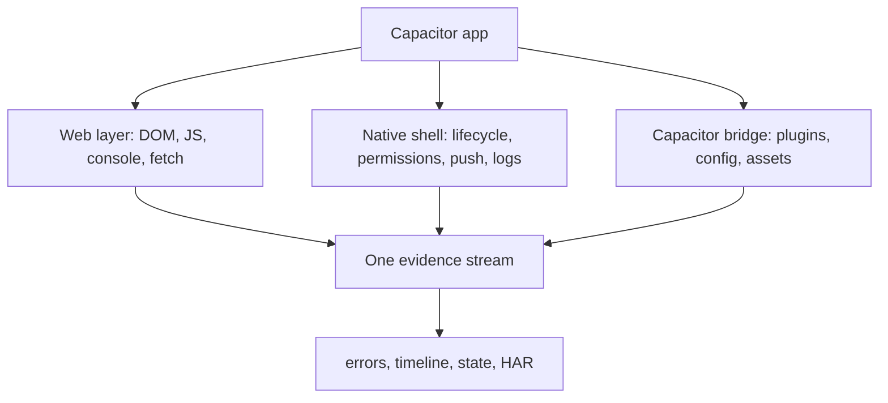
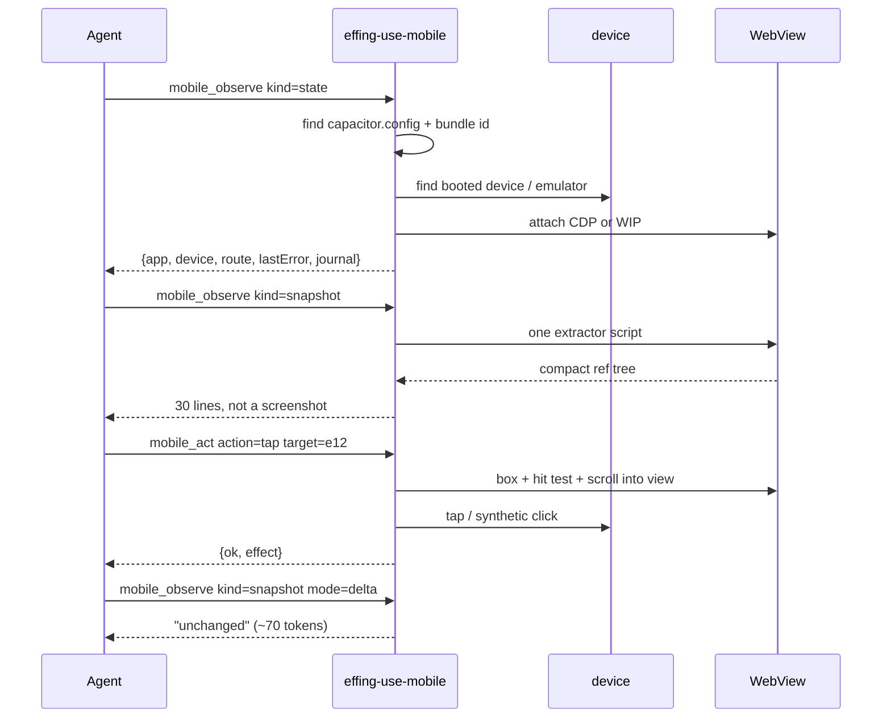

# effing-use-mobile — research and recommendation

**Date:** 2026-11-19 · **Status:** research only, nothing built
**Question:** can we do for mobile apps (Capacitor, specifically) what `effing-use` does
for browsers — 3 tools, token-cheap, fast — and beat what is already on the market?

> **Update 2026-11-20:** built as **its own package** in [`mobile/`](../mobile/README.md)
> (npm `effing-use-mobile`, own container image, `mobile-v*` release tags). §14 was
> answered "all recommended" except 14.2 (Bun, not Node — this repo's `.js`
> specifiers do not resolve under Node without a build step). What shipped, what is
> verified and what still needs a device: [`MOBILE.md`](MOBILE.md).

**Short answer:** yes, and the gap is narrower and more specific than "mobile testing is
hard". Every leading mobile MCP drives the _device_ through the accessibility tree or
screenshots. None of them drives the _WebView_. For a Capacitor app that is the wrong end
of the telescope.

---

## 1. The ask, verbatim

> "I want to make a new app here called effing-use-mobile for us to do the same thing but
> for mobile dev we need to make an mcp that efficintly and properly allows us to work on,
> debug and test our mobile apps, we build ours with capacitor though, we need somehting as
> better than what is on the market right now, once that is fast easy to use for the agents
> while being toekn efficient and you cna use exisiting tools as ideas or something, research
> and get back to me first"

| Ask                                 | Reading                                                                                  | Status            |
| ----------------------------------- | ---------------------------------------------------------------------------------------- | ----------------- |
| New app called `effing-use-mobile`  | Separate package/repo, same design language, its own release cadence                     | Answered in §14.1 |
| Work on, debug and test mobile apps | Launch, drive, inspect, capture evidence, reproduce failures — not just "tap the screen" | Covered §8–§12    |
| We build ours with Capacitor        | Capacitor-specific knowledge is a first-class feature, not a note in the README          | §7.3, §9          |
| Better than what is on the market   | A defensible axis, measured, not a feature-count contest                                 | §5–§6             |
| Fast, easy for agents               | One call to attach; no server, no drivers, no per-platform glue                          | §8                |
| Token efficient                     | 3 tools; deltas; file paths for binary payloads                                          | §11               |
| Research first                      | This document                                                                            | —                 |

---

## 2. Method, and how much to trust each number

Three kinds of evidence, kept separate:

**Measured here (2026-11-19, this machine).** Handshake bytes, by speaking JSON-RPC over
stdio to the real published packages. Reproduce with
`bun bench/mcp-size.ts <command>`. The proposed 3-tool schema was later measured as
the real package (`bun bench/mcp-size.ts bun mobile/src/index.ts`), which replaced
the throwaway draft.

**Read from primary sources.** Capacitor source and docs, Playwright's Android backend
source, the WebKit inspector protocol directory, Google's iwdp docs, Apple's `simctl`
behaviour as documented by Xcode tooling writers. Links in §15.

**Not verified here.** Anything requiring macOS, an iPhone, or a simulator: iOS WebView
attach, real-device behaviour, `simctl`/`idb`/AXe interactions, and current iOS version
compatibility. Marked `UNVERIFIED` below. This Linux box has `adb` 1.0.41 and an AVD named
`ikoro`, so the Android half _can_ be spiked now; the iOS half cannot.

---

## 3. The market on 2026-11-19, weighed

### 3.1 What an agent pays before it does anything

| Server                        | Version | Tools | `tools/list` bytes | vs. draft mobile schema |
| ----------------------------- | ------- | ----: | -----------------: | ----------------------: |
| **draft `effing-use-mobile`** | —       | **3** |          **4,122** |                    1.0× |
| `effing-use` (browser)        | 0.3.1   |     3 |              4,037 |                    1.0× |
| `@mobilenext/mobile-mcp`      | 1.0.18  |    36 |             33,615 |         **8.2× larger** |
| `appium-mcp`                  | 1.99.3  |    32 |             43,291 |        **10.5× larger** |

Same method for all four: `initialize` → `notifications/initialized` → `tools/list`,
weigh the response. The 8× gap is not a micro-optimisation; it is roughly 7,400 tokens of
context the agent never gets back, in every session, before the first device call.

### 3.2 The capability picture

| Project                             | Driver                                          | Hybrid / WebView                                                                                                                                 | Debug data it actually returns                               | Friction                                            | Notes                                                                                                            |
| ----------------------------------- | ----------------------------------------------- | ------------------------------------------------------------------------------------------------------------------------------------------------ | ------------------------------------------------------------ | --------------------------------------------------- | ---------------------------------------------------------------------------------------------------------------- |
| **mobile-next/mobile-mcp** (10.7k★) | accessibility tree + coordinates; `mobilecli`   | **No.** Hybrid/WebView support is an open request ([#175](https://github.com/mobile-next/mobile-mcp/issues/175), Aug 2025 → still open Apr 2026) | screenshots, element list, logcat/unified log, crash reports | Node + adb/Xcode                                    | The category leader. Also: element lists are filtered by hand, which has caused recurring "element missing" bugs |
| **appium-mcp** (519★)               | Appium + UiAutomator2 / XCUITest                | Yes, via context switching (`NATIVE_APP` / `WEBVIEW`)                                                                                            | page source, screenshots, contexts, logs                     | Appium server, drivers, JDK, WDA build/sign for iOS | The only mature hybrid story, at the cost of a server-shaped install                                             |
| **ios-simulator-mcp** (2.2k★)       | idb + `simctl`                                  | No                                                                                                                                               | AX tree, screenshots, video                                  | macOS, Xcode, idb                                   | Simulator only                                                                                                   |
| **Maestro MCP** (16.4k★)            | black-box accessibility driver                  | No DOM; no iOS physical devices                                                                                                                  | inspect screen, screenshots, YAML flows                      | Java 17 + CLI                                       | Best-in-class for writing flows, not for debugging a WebView                                                     |
| **Expo MCP**                        | RN DevTools + simulator automation              | No WebView                                                                                                                                       | view props, logs, screenshots                                | Expo account, SDK 54+, macOS for iOS                | React Native only                                                                                                |
| **BrowserStack / Sauce MCP**        | cloud real devices                              | Unverified                                                                                                                                       | sessions, screenshots, logs, network                         | account + paid add-on                               | Latency and cost make them a different product                                                                   |
| **Capawesome Capacitor MCP**        | docs index                                      | n/a                                                                                                                                              | none (4 tools)                                               | none                                                | Documentation lookup, not a device tool                                                                          |
| **Capgo MCP**                       | deploy/build/observability                      | reports WebView errors                                                                                                                           | errors, logs, release metrics                                | account                                             | Not device control                                                                                               |
| **mobile-harness** (1★)             | **Android CDP over adb**, Capacitor iOS planned | **Yes, Android WebView**                                                                                                                         | eval, console, network, screenshots, timelines               | Bun + adb                                           | The closest existing thing to this idea. One star, iOS is a stub                                                 |
| **xc-mcp** (102★)                   | `simctl` + idb                                  | Deep AX reads only; web frames not tappable                                                                                                      | 81 tools, crash reports, screenshots                         | macOS, idb                                          | Shows the handshake cost of tool-per-command design                                                              |

### 3.3 Four clusters, one hole

1. **Device drivers** (mobile-mcp, ios-simulator-mcp, ADB MCPs): fast to start, blind to
   the DOM, coordinate-shaped.
2. **Appium wrappers** (appium-mcp, WebdriverIO MCP): can reach the WebView, priced like
   enterprise automation — server, drivers, capabilities, WDA signing.
3. **Framework tooling** (Expo, Maestro, Detox): excellent inside one framework, not for a
   hybrid shell.
4. **Cloud farms**: a different job (device coverage), not the inner dev loop.

The hole: **a zero-install tool that treats a hybrid app's WebView as the app, and the
device as the shell around it.** `mobile-harness` has the right idea and one star; nobody
with distribution has shipped it.

---

## 4. Why the leaders are the wrong tool for a Capacitor app

A Capacitor app is a web app in a native shell. The consequences are concrete:

1. **The AX tree is a lossy view of the DOM.** iOS exposes limited ARIA-backed nodes from
   a `WKWebView`; Android's WebView nodes are similarly partial. Elements with no
   accessible name simply vanish — the mobile-mcp issue tracker has recurring reports of
   exactly this. A `<div role="button">` with an icon and no label does not exist.
2. **Refs become coordinates.** Coordinate taps are brittle under scroll, keyboard,
   safe-area, rotation and dynamic type. The DOM already knows the box; the agent should
   not be doing geometry.
3. **Screenshots cost image tokens.** They are the right fallback, but they are the wrong
   primary loop. A text snapshot with refs is cheaper and unambiguous.
4. **Context switching is a 2012 abstraction.** `NATIVE_APP` ↔ `WEBVIEW` works, but it
   arrives with an Appium server, two drivers, a JDK and a WebDriverAgent build. On a new
   Xcode, WDA is the thing that breaks first.
5. **Nobody correlates layers.** A plugin failure is three facts: a JS console error, a
   native log line, and a rejected promise from the bridge. Today the agent gets them from
   three tools, if at all.
6. **`CapacitorHttp` is a blind spot.** With `plugins.CapacitorHttp.enabled = true`,
   Capacitor patches `fetch`/XHR to run through native HTTP. CDP network capture sees
   nothing. A mobile tool that assumes "WebView = Chrome network" will silently miss the
   requests that matter most.

That last point is the tell: the market's mental model is "device with a screen". Ours is
"web app with a device attached".

---

## 5. The core insight



Three layers, one session:

- **Web layer** — the DOM is the source of truth. Attach over CDP on Android and the
  WebKit Inspector Protocol on iOS. Run the _same_ extractor script on both, so the
  snapshot format, e-refs, deltas and queries are platform-independent.
- **Native shell** — the things a WebView cannot know: launch/terminate, foreground and
  background, permissions, push, deep links, appearance, locale, orientation, device logs,
  crash reports, full-device screenshots.
- **Capacitor layer** — detect the project and bundle id, trace `Capacitor.toNative` /
  `Capacitor.fromNative` plugin calls, notice `CapacitorHttp`, sync assets, reload the
  WebView without a native rebuild.

The agent sees one app, not three toolsets.

---

## 6. What "better" means, operationally

Not more features. Five measurable claims:

| Claim                             | How it is measured                                                  | Target                                        |
| --------------------------------- | ------------------------------------------------------------------- | --------------------------------------------- |
| Smaller handshake                 | `bench/mcp-size.ts`                                                 | ≤ 5 KB, 3 tools (draft: 4,122 B)              |
| Cheaper re-observation            | bytes returned after a no-op action                                 | `unchanged` in < 100 tokens                   |
| Fewer calls to first action       | tool calls from cold start to first successful tap                  | 1 (auto-attach + snapshot)                    |
| Faster than an AX/screenshot loop | wall clock, same flow                                               | no worse than 1× device round-trip per action |
| Better failure evidence           | one call returns web + native + plugin evidence for the last action | `kind=errors` after any `E_*`                 |

If the spike cannot hit the first four, the product is not differentiated and should not
ship. That is the go/no-go.

---

## 7. Proposed product

### 7.1 One line

> **Your Capacitor app's DOM, over MCP — 3 tools, no Appium, no drivers, no screenshots
> unless you ask.**

### 7.2 Surface: still three tools

`mobile_act` (27 actions), `mobile_observe` (18 kinds), `mobile_extract` (8 kinds).
New capability is always an enum value, never a fourth tool.

| Tool             | Values                                                                                                                                                                                                                          |
| ---------------- | ------------------------------------------------------------------------------------------------------------------------------------------------------------------------------------------------------------------------------- |
| `mobile_act`     | `attach, launch, terminate, foreground, background, reload, open_url, tap, fill, type, press, swipe, scroll, back, wait, permission, deep_link, push, appearance, locale, orientation, network, route, sync, note, batch, eval` |
| `mobile_observe` | `snapshot, screenshot, url, title, console, network, errors, logs, crash, plugins, device, apps, frames, keyboard, perf, storage, state, timeline`                                                                              |
| `mobile_extract` | `text, html, table, query, pdf, trace_start, trace_stop, har`                                                                                                                                                                   |

`eval` lives in `act` because it can mutate; `state` lives in `observe` because it is a
read. Neither is duplicated across tools.

The draft schema above measures **4,122 bytes**. Compare: 33,615 for mobile-mcp, 43,291
for appium-mcp.

### 7.3 The zero-config loop



No `attach` call is required when exactly one device and one app are obvious. `attach` is
for the ambiguous case, and `kind=state` says which device/app it picked.

### 7.4 Failure envelope

Every `E_*` response carries the same shape as the browser tool, plus mobile evidence:

```json
{
  "ok": false,
  "code": "E_STALE",
  "message": "Ref e12 is stale — element changed.",
  "hint": "observe kind=snapshot, then use a fresh ref",
  "artifacts": {
    "screenshot": ".effing-mobile/sessions/dev/shot-0042.png",
    "journal": ".effing-mobile/sessions/dev/journal.jsonl",
    "lastCallId": "c-0042"
  },
  "recent": [
    "console.error: Camera.getPhoto failed (2s ago)",
    "plugin Camera.getPhoto rejected: User cancelled (2s ago)",
    "request failed: POST /api/upload net::ERR_ABORTED (2s ago)"
  ]
}
```

This is the feature that changes debugging. The agent does not re-run the flow to find
out what happened; it reads the envelope.

---

## 8. Architecture

```mermaid
graph TD
    T[mobile_act / observe / extract] --> S[session]
    S --> D[device runtime: adb | simctl]
    S --> V[web transport: CDP socket | WIP socket]
    S --> P[capacitor probe: config, bundle id, bridge]
    V --> X[extractor.js: snapshot, query, input]
    D --> L[logs | crash | screenshot | permissions]
    P --> B[toNative / fromNative hook]
    S --> J[(journal.jsonl)]
    X --> J
    B --> J
    L --> J
    J --> Z[errors | timeline | har | state]
```

Deliberate choices:

- **No Playwright.** Playwright's Android support can attach to an Android WebView, but it
  is Android-only, cannot attach to iOS, installs a driver APK for native actions, and the
  `Page` API does not exist on the iOS side. Depending on it would make two platforms two
  codebases. A raw WebSocket JSON-RPC client plus one extractor script gives one codebase.
- **No Appium, no WebDriverAgent, no idb by default.** Each is a large install and a
  signing/build liability. They become _optional native-input backends_ for iOS cases the
  DOM cannot handle.
- **Node 22+, not Bun-only.** Mobile developers have Node; fewer have Bun. Node 22 ships a
  global `WebSocket`, so the runtime dependency list can be just `tmcp` + `valibot`.
  Bun stays for development and tests.
- **Same 3-tool MCP shape as `effing-use`** — `tmcp` + Valibot, stdio and HTTP transports,
  identical error codes where the semantics match.

---

## 9. Platform reality check

This is where honesty matters more than the pitch.

| Capability              | Android emulator / device       | iOS simulator                                                   | iOS real device                        |
| ----------------------- | ------------------------------- | --------------------------------------------------------------- | -------------------------------------- |
| Attach to WebView       | ✅ CDP over `adb forward`       | ✅ WIP via `ios_webkit_debug_proxy` (UNVERIFIED on current iOS) | ✅ WIP via usbmuxd (UNVERIFIED)        |
| DOM snapshot + e-refs   | ✅ `Runtime.evaluate`           | ✅ `Runtime.evaluate`                                           | ✅                                     |
| Trusted tap/type        | ✅ CDP `Input.*`                | ⚠️ synthetic DOM only; native tap needs idb/AXe/WDA             | ⚠️ same                                |
| Console + page errors   | ✅ `Runtime`/`Log`              | ✅ `Console` domain                                             | ✅                                     |
| Network capture         | ✅ CDP `Network`                | ⚠️ `Network` works; request interception is a reported no-op    | ⚠️                                     |
| `CapacitorHttp` traffic | ❌ invisible to CDP             | ❌ invisible                                                    | ❌ invisible → plugin hook or proxy    |
| Screenshot              | ✅ `screencap` / CDP            | ✅ `simctl io` / `Page.snapshotRect`                            | ✅ device screenshot (UNVERIFIED path) |
| Native logs             | ✅ `logcat --pid`               | ✅ `simctl spawn log stream`                                    | ✅ unified log (UNVERIFIED)            |
| Permissions             | ✅ `pm grant/revoke`            | ✅ `simctl privacy`                                             | ❌ not scriptable without WDA          |
| Push                    | ⚠️ needs a debug receiver / FCM | ✅ `simctl push`                                                | ⚠️ APNs only                           |
| Deep link               | ✅ `am start -a VIEW`           | ✅ `simctl openurl`                                             | ✅ `devicectl` / UNVERIFIED            |
| Appearance / locale     | ✅ `cmd uimode`, `settings`     | ✅ `simctl ui`, launch args                                     | ⚠️                                     |
| Network throttle        | ✅ emulator console / `Input`   | ⚠️ no scriptable equivalent                                     | ⚠️                                     |
| Plugin trace            | ✅ JS hook                      | ✅ JS hook                                                      | ✅ JS hook                             |
| Crash reports           | ✅ `logcat -b crash`, tombstone | ✅ `simctl` diagnostics                                         | ⚠️                                     |

Setup is one flag, and Capacitor already sets it in development:
`ios.webContentsDebuggingEnabled` / `android.webContentsDebuggingEnabled` default to true
for dev builds, and on iOS 16.4+ the bridge sets `webView.isInspectable` from it. A release
build is not attachable. Say that in the README instead of letting the agent discover it.

Two iOS-specific constraints found in the primary sources:

- **WebKit's inspector protocol has no `Input` domain.** The protocol directory ships
  `Runtime`, `Page`, `DOM`, `Network`, `Console`, `CSS`, `Debugger`, `Target`, `Timeline`,
  etc. — and no `Input.json`. Playwright _adds_ one in its patched WebKit. So on iOS,
  trusted input over WIP is not available; the DOM path must synthesise events, or the
  tool must shell out to a native input backend.
- **`CSS.*` is reported to hang on iOS WKWebView** and `Page.navigate` is reported removed
  upstream (Nov 2025). The design avoids both: snapshots come from `Runtime.evaluate` and
  navigation uses `location.href` when needed.

Neither is a blocker for the DOM-first design; both are blockers for a "port the web
engine 1:1" design. That is why the extractor is one script, not a Playwright page.

---

## 10. Token and speed budget

| Thing              | Budget                               | Rationale                                  |
| ------------------ | ------------------------------------ | ------------------------------------------ |
| `tools/list`       | ≤ 5 KB, 3 tools                      | Measured 4,122 B for the draft             |
| Snapshot preview   | 4,000 chars, full tree to file       | Same convention as `effing-use`            |
| Delta after action | `unchanged` or changed lines only    | The 55× win in the browser product         |
| Screenshot         | file path, never base64              | Binary in context is the expensive mistake |
| Console / network  | last 50 inline, full journal on disk | Rings exist for speed, not evidence        |
| Logs               | filtered by pid/subsystem, capped    | Log streams are firehoses                  |
| Errors             | deduped with first/last seen + count | One call should answer "what broke"        |

Speed targets to measure in the spike (not yet measured):

| Step                                       | Target   |
| ------------------------------------------ | -------- |
| Android attach (adb forward + WS + enable) | < 500 ms |
| iOS attach (iwdp already running)          | < 1 s    |
| Snapshot round-trip after attach           | < 100 ms |
| Tap round-trip                             | < 150 ms |
| WebView reload                             | < 300 ms |
| Cold launch of an installed app            | < 2 s    |

The one that matters is the loop: snapshot → tap → delta. If that is 300 ms and ~100
tokens, an agent can do a 50-step debugging run inside a normal context window.

---

## 11. Phases and exit criteria

Each phase ends with something demonstrable, not a checklist.

### Phase 0 — Spike, Android only (2–3 days)

Boot the local AVD, install a minimal Capacitor app, attach, snapshot, tap, delta.

Exit criteria:

- `observe kind=snapshot` returns a ref tree in < 100 ms after attach.
- `act action=tap target=eN` changes the UI; the next delta is non-empty.
- A no-op action returns `unchanged` in < 100 tokens.
- `observe kind=console` shows `console.error` from the WebView.
- The whole thing runs on Linux with `adb` only.

This is the go/no-go. If Android is not fast and cheap, stop.

### Phase 1 — The real 3-tool server (1 week)

Launch/terminate/reload, screenshots, errors, network, url/title, doctor, batch, the
failure envelope, and the journal.

Exit criteria: a 30-step flow (login → navigate → submit) runs without a screenshot, and
every failure carries evidence.

### Phase 2 — iOS attach (1 week, needs a Mac)

Spawn/manage `ios_webkit_debug_proxy`, discover the app's WIP target, run the same
extractor, verify console/network/screenshot.

Exit criteria: the same 30-step flow passes on an iOS simulator with no Playwright and no
WDA. If iwdp is unusable on current iOS, this is where the in-app-agent decision is made
(§12).

### Phase 3 — Capacitor is the product (1 week)

`cap sync` / live-reload awareness, project + bundle-id detection, `Capacitor.toNative` /
`fromNative` plugin tracing, `CapacitorHttp` detection, permissions, deep links, push,
appearance/locale, native logs, crash triage.

Exit criteria: a plugin failure (camera denied, filesystem error) is explainable from one
`observe kind=errors` call.

### Phase 4 — Depth

HAR, performance, storage, eval, route/mock, real devices, optional native-input backend,
multi-device.

Exit criteria: a flaky backend can be reproduced deterministically with `action=route`,
and a cold-start regression is visible without opening Xcode.

---

## 12. Risks, ranked

| Risk                                        | Impact                                        | Mitigation                                                                                          | Validate by            |
| ------------------------------------------- | --------------------------------------------- | --------------------------------------------------------------------------------------------------- | ---------------------- |
| `iwdp` broken on current iOS                | High — iOS v1 stalls                          | Spike early; fall back to a tiny in-app agent (Capacitor plugin exposing WS + `evaluateJavaScript`) | Phase 2, day 1         |
| No trusted input on iOS                     | Medium — some widgets ignore synthetic clicks | DOM click first; optional idb/AXe/WDA for native dialogs only                                       | Phase 1 on a real form |
| `CSS.*` / `Page.navigate` gaps in WIP       | Low — design avoids them                      | `Runtime.evaluate` + `location.href`                                                                | Phase 2                |
| `CapacitorHttp` hides network               | Medium — misleading "no requests"             | Detect config; label network as "WebView only" unless a plugin/proxy path is enabled                | Phase 3                |
| Android WebView socket discovery edge cases | Low                                           | Poll `/proc/net/unix` + `/json`; `doctor` explains failures                                         | Phase 0                |
| Real iOS devices need different transports  | Medium                                        | WebView attach over usbmux; native input deferred                                                   | Phase 4                |
| Eval + device control is a security surface | High                                          | Loopback-only HTTP, `ALLOW_EVAL=0` default, redaction, no arbitrary shell in v1                     | Phase 1 review         |
| This repo's CI is Linux                     | High for iOS regressions                      | Device-dependent tests opt-in; record fixtures; macOS job later                                     | Phase 2                |

The honest summary: **Android is a low-risk build; iOS is a research spike with a fallback
plan.** That is an argument for starting Android and proving the loop before committing to
an iOS architecture.

---

## 13. What not to build

- **A 40-tool surface.** The handshake is the product's main advantage.
- **A vision loop.** Screenshots as the primary observation mechanism is the thing we are
  trying to replace.
- **An Appium wrapper.** If Appium is the right answer, use `appium-mcp`.
- **A test-framework generator.** Maestro and Detox already own flow authoring. We should
  make flows _debuggable_, not generate YAML.
- **Cloud device farms.** A different product with a different buyer.
- **Release-build support in v1.** Debug builds only; say so in the README.
- **Arbitrary shell.** `adb shell` is an internal primitive, not a model-facing tool.

---

## 14. Decisions I need from you

Recommended answer first, so one word settles each.

**14.1 Repo layout** — separate repo `effing-use-mobile` (recommended: independent release
cadence, different runtime target, no Bun/Playwright baggage), or a folder in this repo
(shared bench, one CI)? Either works; separate is cleaner.

**14.2 Runtime** — Node 22+ (recommended: mobile devs already have it, global `WebSocket`
means zero extra deps), or Bun-only like `effing-use`?

**14.3 iOS strategy** — `ios_webkit_debug_proxy` first, in-app agent as fallback
(recommended: no app changes, works on any debug build), or in-app Capacitor plugin first
(more reliable, but every app must install it)?

**14.4 Start point** — Android spike now on this machine (recommended: AVD `ikoro` and adb
are already here), or wait for a Mac and spike both together?

**14.5 Scope** — Capacitor-first with a generic WebView attach path (recommended), or
Capacitor-only in v1?

Reply with the numbers (`14.1 separate`, `14.2 Node`, …) or say "all recommended".

---

## 15. Sources

Tier varies: Capacitor/Playwright/WebKit source and docs are primary; the `simctl`
recipe page is a practitioner write-up used for flags that `man simctl` also documents.

Measured locally:

- `bench/mcp-size.ts` — MCP handshake weigher.

Reproduce:

```bash
bun bench/mcp-size.ts bun mobile/src/index.ts
bun bench/mcp-size.ts bun src/index.ts
bun bench/mcp-size.ts npx --yes @mobilenext/mobile-mcp@1.0.18
bun bench/mcp-size.ts npx --yes appium-mcp@1.99.3
```

Sources read:

1. Capacitor config schema and defaults — <https://capacitorjs.com/docs/config>
2. Capacitor debugging and live reload — <https://capacitorjs.com/docs/guides/live-reload>
3. Capacitor CLI `run` flags — <https://capacitorjs.com/docs/cli/commands/run>
4. Capacitor iOS inspectability (`webView.isInspectable`) — <https://github.com/ionic-team/capacitor/blob/main/ios/Capacitor/Capacitor/CapacitorBridge.swift>
5. Capacitor native bridge (`toNative` / `fromNative`) — <https://github.com/ionic-team/capacitor/blob/main/core/native-bridge.ts>
6. Capacitor plugin proxy and runtime — <https://github.com/ionic-team/capacitor/blob/main/core/src/runtime.ts>
7. CapacitorHttp (native fetch/XHR patching) — <https://capacitorjs.com/docs/apis/http>
8. Playwright Android WebView backend — <https://github.com/microsoft/playwright/blob/main/packages/playwright-core/src/server/android/android.ts>
9. Playwright Android API — <https://playwright.dev/docs/api/class-android>
10. WebKit inspector protocol domains (no `Input.json`) — <https://github.com/WebKit/WebKit/tree/main/Source/JavaScriptCore/inspector/protocol>
11. iwdp usage and protocol — <https://github.com/google/ios-webkit-debug-proxy>
12. iOS WIP limitations in practice — <https://github.com/echopi/ios-webkit-mcp>
13. `simctl` recipes (privacy, push, openurl, screenshot) — <https://appscreens.com/blog/ios-simulator-commands>
14. Android ADB command reference — <https://developer.android.com/tools/adb>
15. mobile-mcp hybrid WebView request (open) — <https://github.com/mobile-next/mobile-mcp/issues/175>
16. mobile-mcp element filtering rationale — <https://github.com/mobile-next/mobile-mcp/issues/88>
17. Appium hybrid context switching — <https://appium.io/docs/en/latest/guides/hybrid/>
18. WebKit `isInspectable` requirement for iOS 16.4+ — <https://tapscope.ch/docs/guides/ios-webviews/>
19. `mobile-harness` (Android CDP + Capacitor-first iOS plan) — <https://github.com/vucinatim/mobile-harness>
20. `xc-mcp` (tool-per-command cost) — <https://github.com/conorluddy/xc-mcp>

Access date for all URLs: **2026-11-19**.
